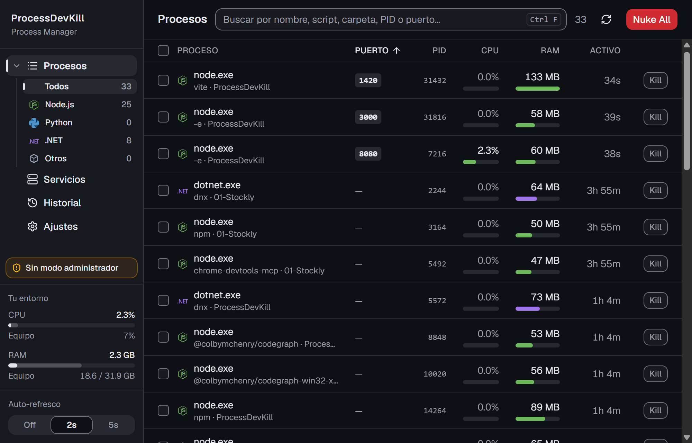
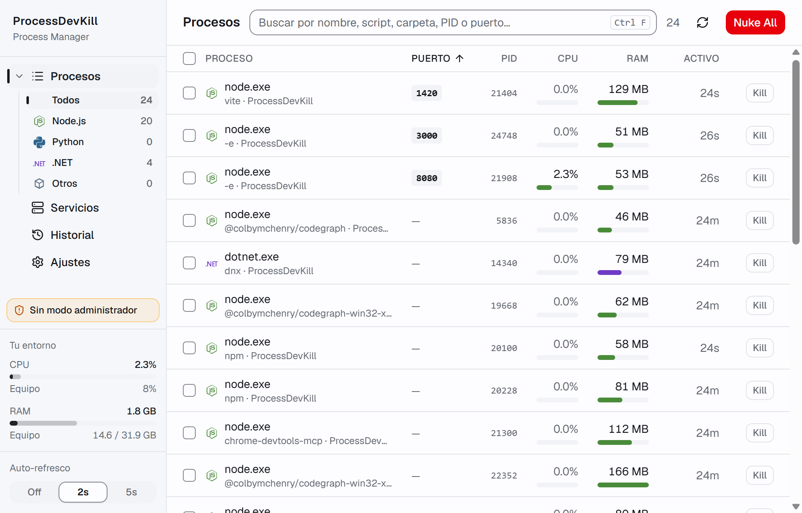
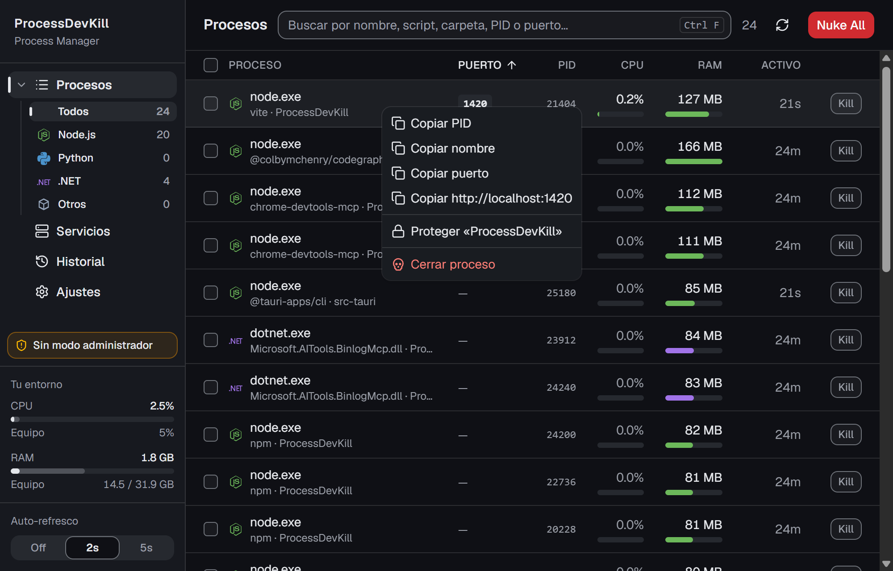
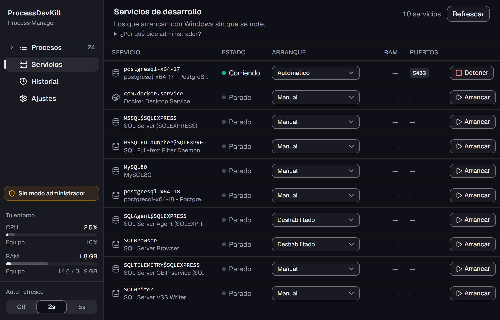
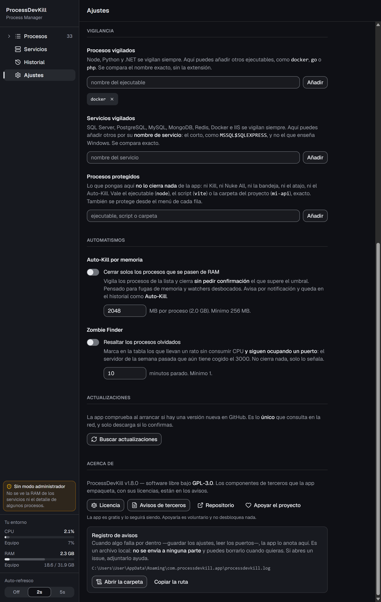
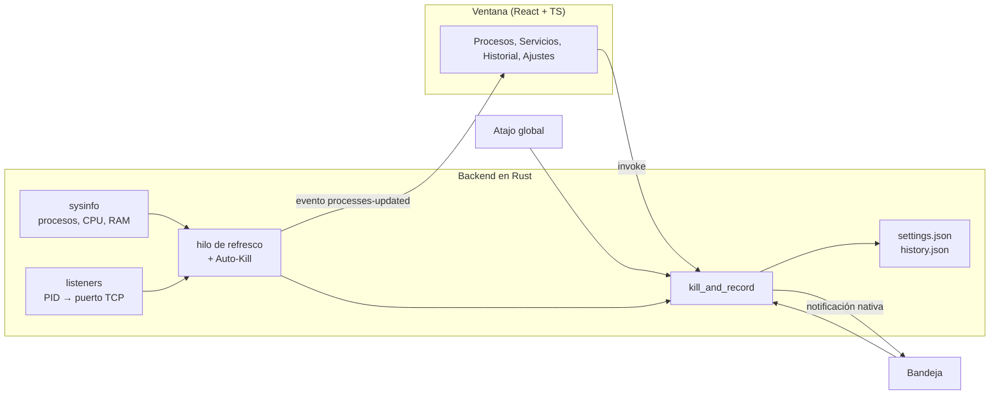

<div align="center">

# ProcessDevKill

**"El puerto 3000 está ocupado y no sé por quién."**

Gestor de procesos de desarrollo para Windows: lista los `node`, `python`, `dotnet`, `java`,
`deno` y `bun` activos con su CPU, su RAM y **el puerto local que ocupa cada uno**, y los cierra de uno en uno o en lote.

[](https://github.com/xfiberex/ProcessDevKill/releases/latest)
[](https://github.com/xfiberex/ProcessDevKill/actions/workflows/ci.yml)
[](LICENSE)
[](#descarga-e-instalación)
[](https://tauri.app)



</div>

## El problema

Un `npm run dev` que sobrevivió al cierre de la terminal, y al día siguiente
`Error: listen EADDRINUSE: address already in use :::3000`. La ruta larga es
`netstat -ano | findstr :3000`, apuntar el PID y `taskkill /PID 12345 /F` cruzando los dedos; el
Administrador de tareas enseña veinte `node.exe` idénticos y no dice cuál escucha en el 3000.
ProcessDevKill enseña esa tabla ya hecha, con el puerto en su columna y un botón al lado.

## Qué hace

| | |
|---|---|
| **Ver qué corre** | **Node, Python, .NET, Java, Deno y Bun** —más los ejecutables que añadas— con CPU, RAM, tiempo activo y puertos TCP en escucha. Debajo de cada `node.exe`, el script y la carpeta del proyecto (`vite · mi-web`). Se busca por nombre, script, carpeta, PID **o puerto** (<kbd>Ctrl</kbd>+<kbd>F</kbd>), y un medidor en el sidebar dice cuánta CPU y RAM se lleva lo que estás desarrollando. |
| **Cerrar sin equivocarte** | **Kill** por fila, por selección o **Nuke All**, con confirmación. Mientras el puntero o el teclado están en la tabla, **las filas no cambian de sitio**. Menú de clic derecho para copiar PID, nombre, puerto o `http://localhost:PUERTO`, proteger o cerrar, e **historial** de cierres con su origen. |
| **Procesos protegidos** | Por ejecutable, script o carpeta: nada de la app los cierra, y los críticos de Windows (`svchost`, `csrss`, `explorer`…) no se pueden vigilar. **Si usas un programa en Java que no es de desarrollo** —un juego, una app de escritorio—, protégelo: Nuke All, la bandeja, el atajo y el Auto-Kill no miran qué es cada fila. |
| **Con el teclado** | La tabla es una sola parada de tabulador: flechas, Inicio y Fin para moverse, Espacio para marcar y <kbd>Supr</kbd> para cerrar, preguntando antes. |
| **Sin abrir la ventana** | Icono en la **bandeja**; **atajo global** que cierra todo lo vigilado con dos pulsaciones; **Auto-Kill** por umbral de RAM; y **Zombie Finder**, que resalta lo que lleva minutos sin CPU **y sigue ocupando un puerto**. Los tres últimos, apagados de fábrica. |
| **Servicios de desarrollo** | SQL Server, PostgreSQL, MySQL, MongoDB, Redis, Docker e IIS, con estado, tipo de arranque y puerto. Se arrancan, se detienen y se les cambia el arranque; Windows pide administrador **solo en ese momento** y la app **anota lo que cambió** para deshacerlo. |
| **Y además** | Tema claro u oscuro (o el de Windows), compatible con los temas de contraste; **español e inglés**, también en la bandeja, las notificaciones y los errores; Ajustes en seis secciones; y **avisa de versiones nuevas** y las instala comprobando su hash. |

<table>
  <tr>
    <td width="50%"><br><sub><em>Tema claro, siguiendo al de Windows</em></sub></td>
    <td width="50%"><br><sub><em>Clic derecho: copiar, proteger o cerrar</em></sub></td>
  </tr>
  <tr>
    <td width="50%"><br><sub><em>Servicios: arrancar, detener y cambiar el arranque</em></sub></td>
    <td width="50%"><br><sub><em>Ajustes: vigilados, protegidos, Auto-Kill y Zombie Finder</em></sub></td>
  </tr>
</table>

<sub>Las capturas las genera [`tools/capture-screenshots.ps1`](tools/capture-screenshots.ps1) conduciendo la app de verdad, con los procesos y servicios reales del equipo; no están retocadas.</sub>

## Descarga e instalación

Desde la **[página de releases](https://github.com/xfiberex/ProcessDevKill/releases/latest)**.
Requiere **Windows 10 o 11 (x64)** con **WebView2**, que viene de serie en Windows 11 y en Windows
10 actualizado. No hay versión de macOS ni de Linux.

| Archivo | Para qué | Tamaño |
|---|---|---|
| `ProcessDevKill_X.Y.Z_x64-setup.exe` | **Recomendado** (NSIS). Se instala en `%LOCALAPPDATA%\ProcessDevKill`, sin pedir administrador. | ~3,9 MB |
| `ProcessDevKill_X.Y.Z_x64_en-US.msi` | MSI, para despliegue por directiva de grupo. | ~6,2 MB |
| `*.sha256` | El hash de cada instalador. Se compara con `Get-FileHash .\archivo.exe -Algorithm SHA256`. | — |

- **El aviso de SmartScreen.** Los instaladores **no están firmados**, así que la primera vez saldrá
  *«Windows protegió su PC»*: **Más información → Ejecutar de todas formas**. Es lo que le pasa a
  cualquier ejecutable sin certificado de firma de código, que el proyecto ha decidido no comprar.
- **Desinstalar:** *Configuración → Aplicaciones → ProcessDevKill*.
- **Actualizaciones:** la app comprueba al arrancar si hay versión nueva y avisa (se apaga en
  *Ajustes → Actualizaciones*). Descargar e instalar **no ocurre solo**: se lanza desde ahí, con las
  notas delante, y la instalación es silenciosa: la app se cierra, se actualiza y vuelve a abrirse.

<details>
<summary><strong>El modelo de confianza de las actualizaciones, y qué no cubre</strong></summary>

El instalador descargado se compara con el **`.sha256` publicado en el mismo release**; si no
coincide, se borra y no se instala. Se vuelve a comprobar **justo antes de ejecutarlo**, y hasta
entonces queda bloqueado para que ningún otro programa lo cambie
([`update.rs`](src-tauri/src/update.rs)). Esto **detecta una descarga corrupta o manipulada**, en
tránsito o en el disco, y nada más:

- **No demuestra quién publicó el archivo.** El instalador y su hash salen del mismo release: no
  protege frente a un compromiso de la cuenta de GitHub.
- **No sustituye a la firma de código**, ni es un paso hacia ella: la firma se descartó el
  2026-08-18. El `.sha256` **es** el mecanismo de integridad del proyecto.
- **Si un release no publicara su `.sha256`, la app se negaría a actualizarse a él.**

</details>

## Privacidad

**Nada de lo que lee sale de tu máquina.** No hay telemetría ni analítica, y la única petición que
hace por su cuenta es la comprobación de actualizaciones a la API de GitHub, que se puede apagar.

<details>
<summary><strong>Qué lee, qué guarda y qué permisos usa</strong></summary>

**Qué lee.** De los procesos vigilados, **nombre, PID, CPU, RAM, tiempo activo y puertos TCP en
escucha**. De esos mismos —no de los ~300 del equipo— lee una vez **la línea de comandos y la
carpeta de trabajo**, y se queda **solo con dos nombres cortos**: el script (`vite`, `server.js`,
`-m uvicorn`) y el último tramo de la carpeta (`mi-api`). **Nunca enseña la línea entera** ni el
código en línea (`node -e …`). El script es el primer argumento que no empieza por `-`, saltando el
valor de las opciones que la app conoce (`-r`, `-X`); una opción **que no conozca** con su valor
separado por un espacio (`node --token abc123 server.js`) enseña ese valor: si pasas secretos por la
línea de comandos, mejor con `=` (`--token=abc123`). Esos nombres viven en memoria y no van al
historial. No lee variables de entorno, ni memoria de procesos, ni archivos. Los servicios se
consultan al **Gestor de control de servicios** solo al abrir o refrescar esa vista, sin privilegios.

**Qué guarda**, todo en `%APPDATA%\com.processdevkill.app\`: `settings.json`; `history.json` (tope
de 200 entradas, se vacía desde la app); `service-changes.json`, **solo** con los tipos de arranque
que cambió la app; y `processdevkill.log`, un registro de fallos internos —no de lo que corre en tu
equipo— para adjuntar a un issue, de **1 MB como mucho**. Su ruta está en *Ajustes → Acerca de*.

**Permisos de administrador.** De fábrica no los tiene. Para tocar un servicio, la app relanza **su
propio ejecutable** con el aviso de UAC; ese proceso hace **una** llamada al sistema y termina, sin
ventana y sin red. Correr elevada entera es opcional, desde Ajustes. Sin ser administrador, la app
**dice lo que no puede ver**: la RAM de los servicios y el script de procesos abiertos desde una
terminal elevada.

**La ventana** tiene los permisos mínimos
([`capabilities/default.json`](src-tauri/capabilities/default.json)): portapapeles de **solo
escritura**, abrir archivos acotado a los dos avisos legales y **ningún** permiso de red ni de
notificaciones; eso lo hace Rust.

</details>

## Cómo funciona

Un hilo de Rust enumera procesos (`sysinfo`) y sockets (`listeners`) y **empuja** el evento
`processes-updated`; React solo escucha. **Todo cierre pasa por `kill_and_record`**: la ventana, la
bandeja, el atajo y el Auto-Kill notifican, registran y rechazan a los protegidos igual. Los puertos
se filtran por **TCP + `Listen`** —si no, saldrían los efímeros de las conexiones salientes—, y la
persistencia son **JSON propios**, porque la bandeja y el atajo escriben con la ventana cerrada. El
resto de decisiones, con su fecha y su motivo, en [CONTEXT.md §4](CONTEXT.md#4-decisiones-tomadas).

<details>
<summary><strong>Diagrama y stack</strong></summary>



| Capa | Tecnología |
|---|---|
| Escritorio | **Tauri 2** (Rust + WebView2), con los plugins `notification`, `global-shortcut`, `clipboard-manager`, `opener` y `tray-icon` |
| Frontend | **React 19 + TypeScript + Vite**, **Tailwind CSS v4**, **shadcn/ui** (`base-nova`, sobre **Base UI**), **Sonner** y **Motion** |
| Procesos y puertos | crates **`sysinfo`** y **`listeners`** (`sysinfo` no expone los puertos) |
| Actualizaciones | **`reqwest`** (rustls) + **`sha2`**: implementación propia, sin plugin |
| Pruebas y CI | **Vitest + Testing Library**, `cargo test` y **GitHub Actions** en `windows-latest` |

</details>

## Desarrollo

Prerequisitos: **Node.js LTS**, **[rustup](https://rustup.rs)** —instala solo el compilador fijado
en [`rust-toolchain.toml`](rust-toolchain.toml)— y los **MSVC C++ build tools x64/x86** con el
**Windows SDK** (`Microsoft.VisualStudio.Component.VC.Tools.x86.x64`); sin ellos, `cargo` falla al
enlazar.

```bash
npm install
npm run tauri dev                         # app de escritorio con hot reload
npm run build                             # comprueba tipos y compila el frontend
npm run lint                              # ESLint
npm test                                  # frontend: Vitest + Testing Library, en jsdom
cd src-tauri && cargo test                # backend: lee los procesos reales del equipo
cd src-tauri && cargo clippy --all-targets --features envivo
npx tauri build --no-bundle               # binario de release (no `cargo build --release`)
node tools/prueba-en-marcha.mjs           # el binario de release, arrancado y conducido
cd src-tauri && cargo clean               # borra src-tauri/target (ver abajo)
```

- **Las pruebas no tocan tus procesos**: las de Rust solo cierran los que lanzan ellas, y las del
  frontend doblan los módulos de Tauri. [`src/types.test.ts`](src/types.test.ts) lee el fuente de
  Rust y comprueba que los tipos espejo siguen coincidiendo.
- **El binario de release se compila con `npx tauri build --no-bundle`**: el que sale de
  `cargo build --release` no lleva el frontend dentro y la ventana enseña `ERR_CONNECTION_REFUSED`.
- **Espacio en disco.** `src-tauri/target` crece con cada compilación —debug, release y la copia de
  pruebas `envivo`— y puede pasar de **15 GB**. `cargo clean` lo borra entero sin perder nada del
  repositorio; la siguiente compilación tarda unos minutos más porque rehace las dependencias.
- **Integración continua.** [`ci.yml`](.github/workflows/ci.yml) pasa ESLint, las dos suites,
  `npm run build` y clippy en `windows-latest` en cada push y pull request, y `npm audit` y
  `cargo audit` también **cada lunes**. Son las mismas comprobaciones que hace `release.ps1`; la CI
  **solo comprueba**, sin secretos. Las pruebas en marcha se lanzan a mano con
  `gh workflow run en-marcha.yml`.

| Herramienta | Para qué |
|---|---|
| [`release.ps1`](release.ps1) | Corta una versión entera: pruebas, versión en los tres sitios, build, `.sha256`, tag, GitHub Release y comprobación de lo publicado. Antes, `-DryRun`. |
| [`tools/prueba-en-marcha.mjs`](tools/prueba-en-marcha.mjs) | Arranca una copia de release con otro identificador y comprueba que lista, cierra, protege y descarga como dice. `--sin-compilar` reutiliza el binario. |
| [`tools/auditoria-ui.mjs`](tools/auditoria-ui.mjs) | Deja capturas y medidas —tamaños, zoom, foco, contraste, axe— fuera del repositorio. Mide, no comprueba; `--fases` elige cuáles. |
| [`tools/envivo.mjs`](tools/envivo.mjs), [`tools/ventana-real.ps1`](tools/ventana-real.ps1) | Lo que comparten los guiones anteriores para llegar a la app, y las ventanas y teclas de Windows que no se alcanzan por CDP. |
| [`tools/capture-screenshots.ps1`](tools/capture-screenshots.ps1) | Regenera las capturas de este README con una copia aparte de la app. |
| [`tools/avisos-de-terceros.mjs`](tools/avisos-de-terceros.mjs) | Genera `THIRD-PARTY-NOTICES.txt`; con `--comprobar`, dice si se quedó viejo. |
| `npm run tauri icon app-icon.svg` | Regenera todos los tamaños de icono tras editar `app-icon.svg`. |

<details>
<summary><strong>Estructura del repositorio y documentación</strong></summary>

| Ruta | Contenido |
|---|---|
| `src/` | Frontend: vistas, `components/`, `hooks/`, `lib/`, tipos espejo de Rust y textos en los dos idiomas (`i18n.tsx`) |
| `src/components/ui/` | Componentes de shadcn/ui (generados; se editan a mano si hace falta) |
| `src-tauri/src/lib.rs`, `commands.rs` | Arranque y estado compartido; los comandos que llama la ventana |
| `src-tauri/src/{lista,processes,ports,storage}.rs` | La lista y el cierre, procesos, puertos y persistencia |
| `src-tauri/src/{poller,auto_kill,tray,hotkey,notify}.rs` | Hilo de refresco, Auto-Kill, bandeja, atajo global y avisos nativos |
| `src-tauri/src/{services,service_control,elevation}.rs` | Servicios (lectura), su control elevado con guardia, y la elevación de la app |
| `src-tauri/src/{textos,update,logging}.rs` | Texto de Rust en los dos idiomas, actualizaciones y registro de avisos |
| `src-tauri/capabilities/` | Permisos concedidos a la ventana |
| `tools/`, `docs/screenshots/`, `.github/workflows/` | Utilidades, capturas de este README y la CI |
| `.claude/skills/`, `.agents/skills/` | Packs de skills de agente (de terceros; ni se compilan ni se distribuyen) |

| Documento | Responde a |
|---|---|
| [CHANGELOG.md](CHANGELOG.md) · [CHANGELOG.en.md](CHANGELOG.en.md) | ¿Qué cambió en cada versión? |
| [ROADMAP.md](ROADMAP.md) | ¿Qué falta por hacer? |
| [CONTEXT.md](CONTEXT.md) | ¿En qué estado está, y por qué se decidió así? |
| [.claude/CLAUDE.md](.claude/CLAUDE.md) | ¿Cómo se trabaja en este repositorio? |
| [docs/TIERS-1-11.md](docs/TIERS-1-11.md), [TIER-12](docs/TIER-12.md), [TIER-13](docs/TIER-13.md), [REVISION-2026-08-18](docs/REVISION-2026-08-18.md) | ¿Qué se hizo ya, y qué enseñó? |
| [docs/BITACORA.md](docs/BITACORA.md) | ¿Cómo se llegó hasta aquí, sesión a sesión? |

</details>

## Estado y licencia

La versión actual es la **v1.10.7**; la primera pública fue la v1.1.1. Lo que viene está en el
[ROADMAP](ROADMAP.md). Lo que **no** hay: **firma de código** —el aviso de SmartScreen va a seguir
saliendo— ni versiones para **macOS o Linux**.

Software libre bajo la **[GNU General Public License v3.0](LICENSE)**: puedes usarlo, estudiarlo,
modificarlo y redistribuirlo, **siempre que los derivados conserven la misma licencia y publiquen su
código fuente**. Se ofrece **sin ninguna garantía**. Las licencias de lo que empaqueta el instalador
—incluida la tipografía Geist (OFL-1.1)— están en [THIRD-PARTY-NOTICES.txt](THIRD-PARTY-NOTICES.txt),
generado por [`tools/avisos-de-terceros.mjs`](tools/avisos-de-terceros.mjs); todas son compatibles
con la GPLv3, aunque **no ha pasado una revisión legal**. Los **18 packs de skills de agente** de
`.claude/skills/` y `.agents/skills/` (unos 270 de los 430 archivos versionados) **no forman parte
de la app**; su procedencia y sus licencias, incluidos los ocho que no declaran ninguna, están en la
sección 5 de ese mismo archivo.
